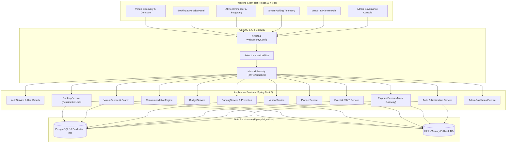
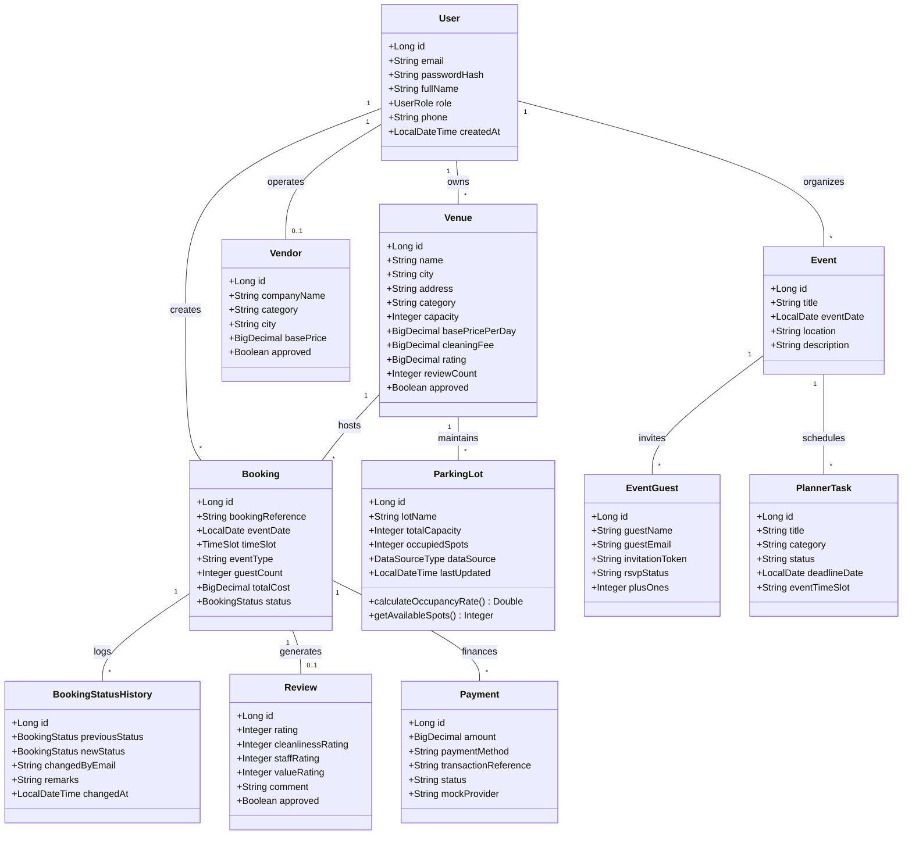
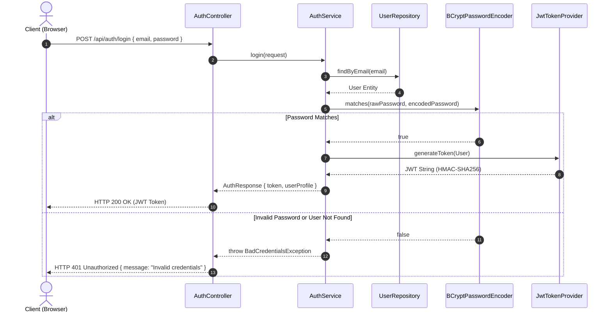
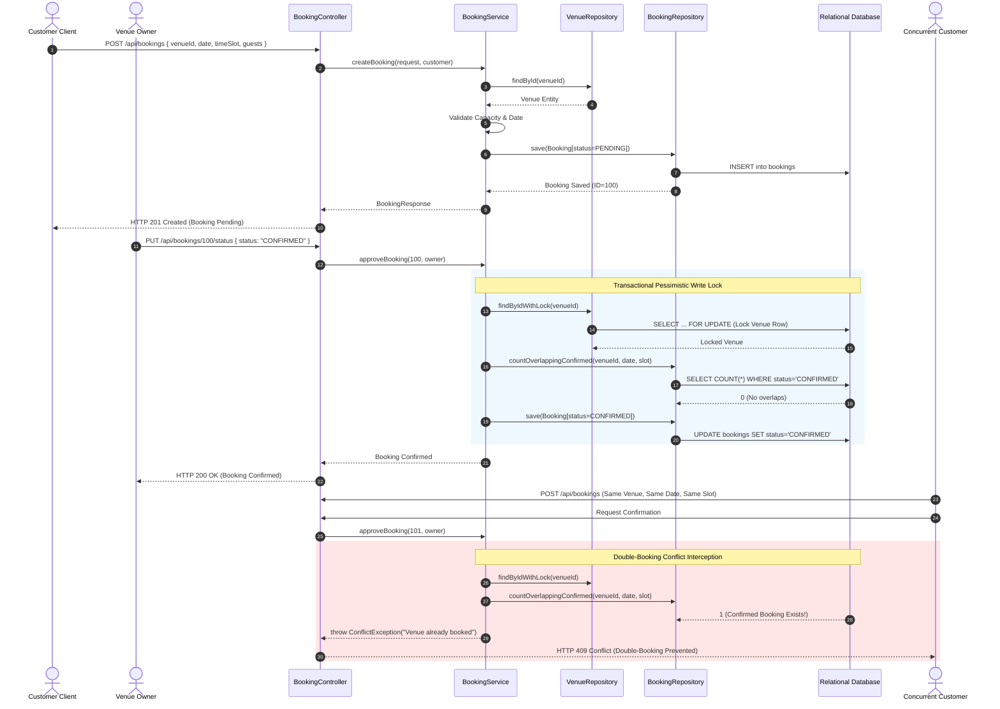
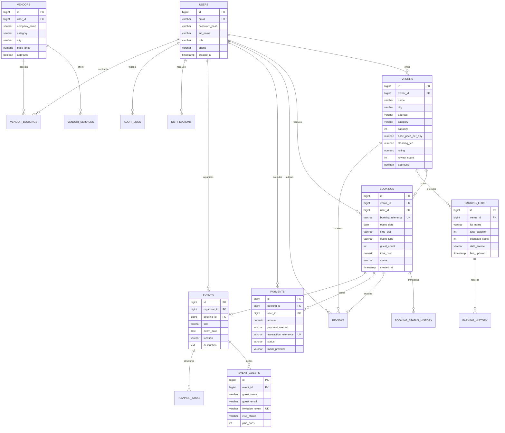

# Software Architecture Document
## Smart Event Venue Booking, Planning, and Management System with Parking Assistance

**Document Identifier:** SCM-DOC-ARCH-03  
**Version:** 1.0.0  
**Status:** Approved / Baselined  
**Project:** Smart Event Venue Management System (SCM Course Project)  
**Date:** October 2026  

---

### 1. System Architecture Diagram

---

### 2. Use Case Diagram

```mermaid
flowchart TD
    actorCustomer["Customer"]
    actorOwner["Venue Owner"]
    actorVendor["Vendor"]
    actorAdmin["Administrator"]

    subgraph VenueModule["Venue Management"]
        UC1["Discover & Filter Venues"]
        UC2["Compare Venues"]
        UC3["Create Venue Listing"]
        UC4["Approve/Reject Venue Listings"]
    end

    subgraph BookingModule["Reservation Lifecycle"]
        UC5["Request Venue Booking"]
        UC6["Review & Approve Booking"]
        UC7["Prevent Overlapping Double-Booking"]
        UC8["View & Print Itemized Receipt"]
    end

    subgraph AIAndSmartServices["AI & Smart Logistics"]
        UC9["Get Weighted AI Venue Recommendations"]
        UC10["Estimate Event Budget"]
        UC11["View Live & Predicted Parking Occupancy"]
        UC12["Update Parking Deck Counts"]
    end

    subgraph MarketAndFulfillment["Event Execution & Marketplace"]
        UC13["Book Vendor Catering / Decor Services"]
        UC14["Accept / Fulfill Vendor Order"]
        UC15["Manage Template Planner Checklist"]
        UC16["Issue Guest Invitations & Token RSVP"]
        UC17["Submit Verified Review"]
        UC18["Process Sandbox Mock Payment"]
    end

    subgraph GovernanceModule["Auditing & Governance"]
        UC19["Monitor Real Telemetry & Audit Logs"]
        UC20["Manage User Roles & Permissions"]
    end

    actorCustomer --> UC1
    actorCustomer --> UC2
    actorCustomer --> UC5
    actorCustomer --> UC8
    actorCustomer --> UC9
    actorCustomer --> UC10
    actorCustomer --> UC11
    actorCustomer --> UC13
    actorCustomer --> UC15
    actorCustomer --> UC16
    actorCustomer --> UC17
    actorCustomer --> UC18

    actorOwner --> UC3
    actorOwner --> UC6
    actorOwner --> UC7
    actorOwner --> UC12

    actorVendor --> UC14

    actorAdmin --> UC4
    actorAdmin --> UC19
    actorAdmin --> UC20
```

---

### 3. Domain Class Diagram

---

### 4. Authentication Sequence Diagram

---

### 5. Booking & Pessimistic Concurrency Sequence Diagram

---

### 6. Entity-Relationship (ER) Diagram

